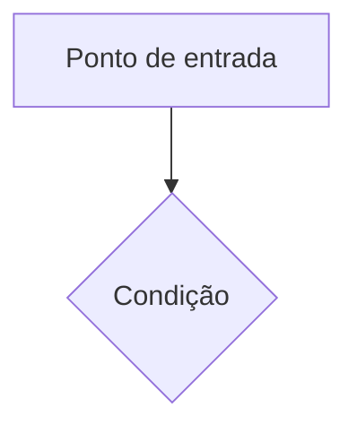
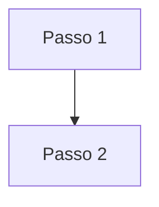
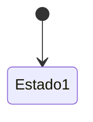

# App Flow · [Nome do projeto]

**Versão:** 1 · **Data:** [DD/MM/AAAA] · **Status:** em revisão

> Descreve os caminhos: por onde a pessoa entra, o que vê, o que acontece a cada ação e o que o
> sistema faz por trás. Cada fluxo cita os `RF-xx` do [PRD](prd.md).

## 1. Inventário de telas

| Tela | Endereço | RF |
| --- | --- | --- |
| [Tela] | `[/caminho]` | RF-xx |

## 2. Entradas

## 3. [Fluxo principal]

**Mensagens**

| Situação | Texto |
| --- | --- |
| [Erro ou estado] | [Texto exato mostrado] |

**Regras**

- [Regra de comportamento que não cabe no diagrama.]

## 4. [Ciclo de vida de um objeto do sistema]

## 5. Pontos em aberto

- [ ] [Pergunta.]
