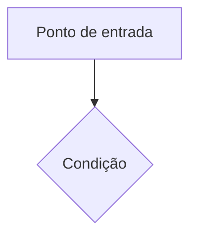
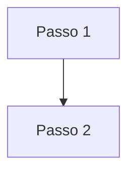
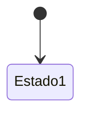

# App Flow · [Nome do projeto]

**Versão:** 1 · **Data:** [DD/MM/AAAA] · **Status:** em revisão

> Descreve os caminhos: por onde a pessoa entra, o que vê, o que acontece a cada ação e o que o
> sistema faz por trás. Cada fluxo cita os `RF-xx` do [PRD](prd.md).

## 1. Inventário de telas

| Tela | Endereço | RF |
| --- | --- | --- |
| [Tela] | `[/caminho]` | RF-xx |

## 2. Entradas

## 3. [Fluxo principal]

**Mensagens**

| Situação | Texto |
| --- | --- |
| [Erro ou estado] | [Texto exato mostrado] |

**Regras**

- [Regra de comportamento que não cabe no diagrama.]

## 4. [Ciclo de vida de um objeto do sistema]

**Estados** (regra 18 do processo, para rotina ou pipeline com mais de uma etapa)

| Estado | Significado | Ação |
| --- | --- | --- |
| `[estado]` | [O que já foi feito] | [O que o sistema ou a pessoa faz a partir dele] |
| `erro` | Falha técnica ou contrato inválido | Corrigir a causa e `retomar` |

**Caminho de falha:** a rotina cai na etapa [N]; o estado e o hash gravados até ali ficam;
`retomar` continua da etapa [N] sem refazer as anteriores. Aval guarda o hash do aprovado; o que
mudou depois do aval volta para `[estado da fila]`.

## 5. Pontos em aberto

- [ ] [Pergunta.]
