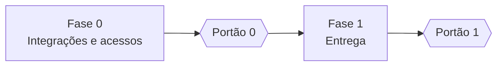
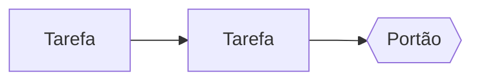

# Plano de implementação · [Nome do projeto]

**Versão:** 1 · **Data:** [DD/MM/AAAA] · **Status:** em revisão

> Responde **quando** e **em que ordem**. Cada tarefa cita os `RF-xx` que entrega.

## 1. Resumo

| Fase | Entrega | Esforço estimado | Portão de saída |
| --- | --- | --- | --- |
| 0 · Integrações e acessos | Contas, permissões, credenciais e textos | [~N h do responsável] | Cada integração testada com uma chamada de leitura |
| 1 · [Nome] | [Entrega] | [~N dias] | [Critério verificável] |

As estimativas são de esforço, não prazo. **Quem faz:** "Você" é uma pessoa da March com acesso de
administrador; "Dev" é desenvolvimento (pessoa ou agente). Contas, acessos, DNS, regras de acesso a
servidores e textos jurídicos não são delegados a agentes.

## 2. Fase 0 · Integrações e acessos

### 2.1 Como as credenciais chegam ao servidor

| Tipo | Caminho |
| --- | --- |
| Segredo usado pela aplicação | Gravado pelo responsável no `.env` do servidor, permissão 600 |
| Segredo usado pelo CI | Secrets do repositório no GitHub |
| Segredo que vive numa plataforma | Colado direto no painel da plataforma |
| Identificador público | Pode ir ao repositório |

### 2.2 Integrações

| ID | Plataforma | O que fazer | Onde | Como entrega | Tempo | Bloqueia |
| --- | --- | --- | --- | --- | --- | --- |
| P0-01 | [Plataforma] | [Ação] | [Tela] | [Caminho da credencial] | [min] | [Tarefa] |

### 2.3 Conteúdo

| ID | O que fazer | Bloqueia |
| --- | --- | --- |
| C-01 | [Texto, aprovação jurídica, dado do cliente] | [Tarefa] |

**Portão 0:** [critério].

## 3. Fase 1 · [Nome]

| ID | Tarefa | Quem | Esforço | Depende de | RF |
| --- | --- | --- | --- | --- | --- |
| P1-01 | [Tarefa] | Dev | [d] | | RF-xx |

**Portão 1:** [critério verificável].

## 4. Caminho crítico

## 5. Riscos de cronograma

| Risco | Efeito | Resposta |
| --- | --- | --- |
| [Risco] | [Efeito] | [Resposta] |

## 6. Pontos em aberto

- [ ] Data de início e dedicação.
