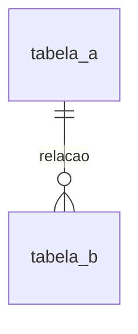

# Schema do Backend · [Nome do projeto]

**Versão:** 1 · **Data:** [DD/MM/AAAA] · **Status:** em revisão

> Define os dados e os contratos: tabelas, endpoints e cargas trocadas com outros sistemas. O
> comportamento está no [TRD](trd.md); os caminhos de tela, no App Flow.
>
> [Projeto sem back-end: substituir tudo abaixo por uma linha dizendo "Não se aplica" e o porquê.]

## 1. Modelo de dados



## 2. Tipos

```sql
-- [enums e tipos compartilhados]
```

## 3. Tabelas

### `[tabela]`

| Coluna | Tipo | Nulo | Observação |
| --- | --- | --- | --- |
| `id` | `uuid` | não | |

Índices: [lista].

## 4. Valores fechados

| Campo | Valores |
| --- | --- |
| [campo] | [valor · valor · valor] |

## 5. API

Base: `[URL]`. Formato de erro: `[formato]`.

| Método e caminho | Uso | Respostas |
| --- | --- | --- |
| `[MÉTODO /caminho]` | [Uso] | [Códigos] |

### `[MÉTODO /caminho]`

```json
{ "[campo]": "[exemplo]" }
```

## 6. Cargas de saída

[O que é enviado a cada sistema externo, com exemplo e regras de normalização.]

## 7. Retenção e exclusão

| Dado | Retenção | Observação |
| --- | --- | --- |
| [Dado] | [Prazo] | [Por quê] |

## 8. Migrações

[Ferramenta, pasta, usuários do banco.]
